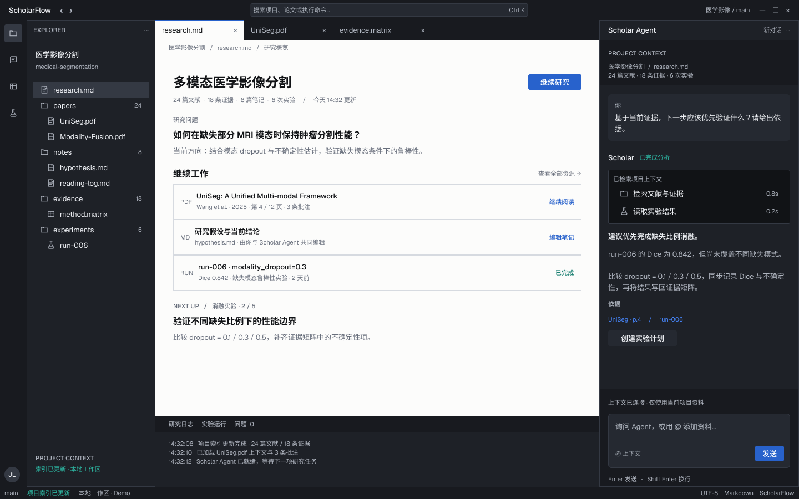

# ScholarFlow IDE 工作区 · v1

[打开实际工作区画板](https://www.figma.com/design/rQ8doN3vOtVhHFFrhhPxFp?node-id=10-2)，不是封面或空白页。

## 设计方向

参考 VS Code / Codex 的工具型工作区语言，重新组织内容，而非仅换色：

- 顶部紧凑命令搜索、左侧 Activity Rail 与真实项目资源树。
- 中央以打开的 research.md 为主体，保留编辑器标签页和面包屑。
- 移除巨大 Hero、统计卡片和 dashboard 拼贴，改用行内项目上下文、研究问题、连续资源队列和下一步研究。
- 底部研究日志；右侧 Agent 展示项目上下文、用户请求、工具执行、分析依据和输入区。
- 石墨色外壳、浅色文档、Geist 字体、细分隔线、低圆角和低阴影。

Figma 内包含 3 个变量集合、62 个 token、6 个文字样式、2 个效果样式、5 组工作区组件和 5 个仓库 SVG 图标。页面使用组件实例，基础色／文字／间距均可编辑。

## 验证与范围

- 工作区 1440×900；完整加载实例子节点后检查 87 个文字节点、43 个实例。
- 字体偏差 0，未绑定的颜色 0，布局溢出 0，文字对比度失败 0。
- 整页最小文字对比度 4.788:1；浅色与深色区域使用独立链接／成功状态 token。
- 已检查整页和各组件截图，预览 PNG 为原始分辨率。
- 本次仅交付可编辑视觉方案，不是可运行网页，也没有点击原型。
- 主仓库 `demo/index.html` 未改动。基线提交 `56136bee42a073d14ccf5b0bccd5f24ef08d71c5`，HTML blob `5858930dc87500086b124a83b24973d800796787`。
- 研究内容沿用 demo 的 mock 项目材料，不代表真实文献结论。

确认视觉方向后再实现主页面，并保留原有六个视图和交互入口。旧 worktree 实验保持独立，本次未合并或清理。

状态、精确节点 ID 和验证数据分别保存在 `figma-state-scholarflow-ide-v1.json`、`figma-audit-scholarflow-ide-v1.json`。验证命令：`powershell -ExecutionPolicy Bypass -File tests/figma-workspace.tests.ps1`。
