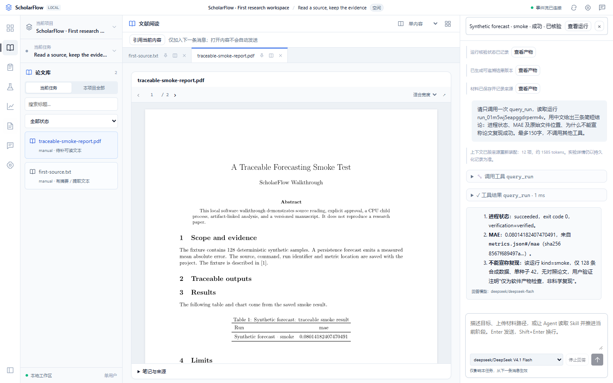
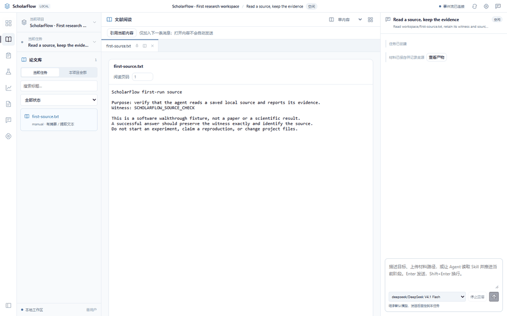
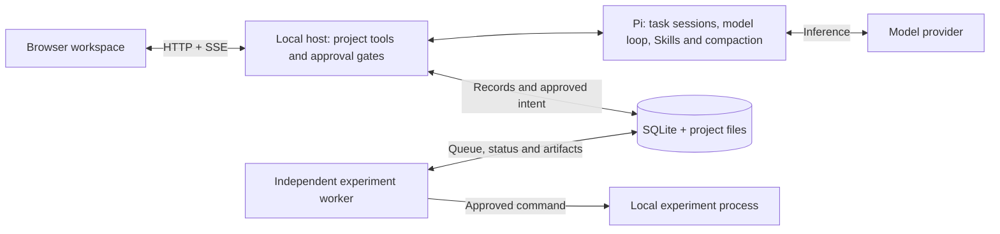

<p align="center"></p>

# ScholarFlow

**Research that keeps its memory, evidence, and progress.**

A local-first research workspace built on Pi. Organize sources, discuss plans, run approved experiments, inspect results, and work on LaTeX manuscripts in one project—with source-linked memory across tasks.

  

[简体中文](README.md) · **English**

[Demo](#see-it-in-action) · [Quickstart](#quickstart) · [Architecture](#how-it-works) · [Documentation](docs/README.md) · [Roadmap](#whats-next)



*Captured from the running app with example material and a real model conversation. The current interface is in Chinese. Windows-first, single-user early preview.*

## Why ScholarFlow?

Research continues across conversations, processes, and files. ScholarFlow keeps the context and evidence needed to pick that work back up.

| What you need | What the workspace provides |
| --- | --- |
| Continue research in another task | Project-scoped memory with sources, versions, effective dates, corrections, and unresolved disputes. |
| Keep long tasks manageable | Capabilities and Skills loaded on demand, bounded source reads, input budgets, and recovery from persisted records after Pi compaction. |
| Know what an experiment actually did | Explicit approval, request deduplication, snapshots, logs, and metrics tied to the original run and file. |
| Review changes to the agent's methods | Isolated Skill candidates, paired evaluation, user-confirmed publication, task version bindings, and rollback. **Improvement effectiveness remains experimental.** |

## See it in action

[Open the walkthrough](docs/DEMO.md): follow a source into a real conversation, approve a CPU smoke run, inspect its recorded metric, build a manuscript, and recall a confirmed memory in a new task.

<details>
<summary>Play the sampled workflow walkthrough</summary>



This walkthrough samples real UI states; pauses are adjusted for readability. Its experiment uses synthetic smoke data and demonstrates the software workflow. It is not a paper reproduction or evidence of scientific performance. [Capture details](docs/assets/manifest.json).

</details>

## Quickstart

**Required:** Windows and Node.js **22.19 or newer** (tested with Node 24.21). A DeepSeek API key is needed for an actual agent conversation.

```powershell
git clone https://github.com/qiqi-feeder/ScholarFlow.git
cd ScholarFlow
npm ci
npm run build
npm start
```

Open [localhost:8787](http://127.0.0.1:8787). In **Settings / 设置**, configure your DeepSeek key and model. The key is stored in local host configuration, separately from project data.

Python/Conda, a dataset, and an approved resource budget are needed for your target experiments. `pdflatex` and `bibtex` are needed to build manuscript PDFs. These are optional for the first source-reading example; see the [run guide](docs/RUN_GUIDE.md) for setup and recovery.

### Read your first source

With the server still running, open a second terminal in this repository:

```powershell
npm run demo:seed
```

This creates an example project, task, and local source. Running it again reuses those records and refuses to overwrite locally edited source files. It does not call a model, approve an experiment, or publish a method.

1. Refresh the workspace and select **ScholarFlow · First research workspace**.
2. Select **Read a source, keep the evidence**. Open `first-source.txt` from **Materials / 材料** and use **Reference current content / 引用当前内容**.
3. Send this prompt:

```text
Read workspace/first-source.txt with read_artifact. Reply with the exact witness
and the source path. Do not run experiments or change files.
```

Expect the witness **`SCHOLARFLOW_SOURCE_CHECK`** and a source path in the answer. A missing key or failed request produces a visible error. [Example source](examples/first-source.txt).

## How it works



Pi supplies the model loop, sessions, Skill loading, and compaction. ScholarFlow adds the research workspace, scoped memory, capability assembly, experiment lifecycle, provenance, and controlled method versioning. The browser talks to the local host; experiments run independently of the conversation and browser connection.

Explore the [current Agent architecture](docs/AGENT_CAPABILITY_ARCHITECTURE.md), [implementation contracts](docs/AGENT_IMPLEMENTATION_PLAN.md), and [source layout](docs/README.md#source-map).

## Verification and current limits

```powershell
npm run verify        # Type checks, automated tests, and production build
npm run test:browser  # Requires Chrome or Edge
npm run test:docs     # README, links, evidence, and documentation contracts
```

The [IG00–IG07 delivery report](docs/verification/agent-implementation/IG07.md) links software, real API, browser, and restart evidence. External API checks are opt-in and require credentials; [CONTRIBUTING.md](CONTRIBUTING.md) explains their cost and scope.

- **Software workflow implemented; target research acceptance pending.** An approved real-paper baseline and controlled modification have not been completed.
- **Method improvement is not established.** In the latest six-card lightweight evaluation, both baseline and candidate passed 4/6. The candidate was rejected and the baseline retained. These are behavior checks, not a research benchmark.
- **Local execution has host-account permissions.** Project checks are not an operating-system sandbox. Keep the service on loopback and run reviewed code. [Runtime boundaries](docs/RUN_GUIDE.md#6-安全边界).
- Full-text acquisition and some research-workspace tool contracts remain unfinished. Model support is limited to the configured capabilities exposed by Pi and the combinations actually verified.

## What's next

- Complete one approved paper reproduction and a controlled modification with traceable outputs.
- Improve public full-text acquisition and precise evidence locations.
- Expand independent method evaluation and diagnose failure cases before claiming improvement.

See [PLAN.md](PLAN.md) for dependencies, acceptance gates, and the detailed roadmap.

## Documentation and contribution

[Run and recover](docs/RUN_GUIDE.md) · [Documentation index](docs/README.md) · [Verification](docs/verification/agent-implementation/IG07.md) · [Contribute](CONTRIBUTING.md) · [Report an issue](https://github.com/qiqi-feeder/ScholarFlow/issues)

The project-wide license is pending maintainer selection. Dependencies retain their own licenses; see [third-party notices](docs/m0/UPSTREAM_LICENSES.md). Built with [Pi](https://github.com/earendil-works/pi).
