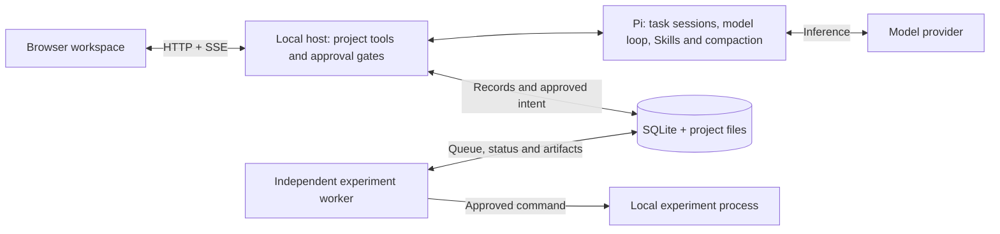

<p align="center"></p>

# ScholarFlow

**有记忆、可追溯、可恢复的科研 Agent 工作台。**

基于 Pi 构建的本地科研工作区。把文献、讨论、实验、结果和 LaTeX 稿件组织在同一项目中，让 Agent 跨任务接续工作，并保留来源、条件与版本。

  

**简体中文** · [English](README.en.md)

[查看演示](#看看实际工作流程) · [快速开始](#快速开始) · [架构](#它如何工作) · [文档](docs/README.md) · [后续计划](#接下来做什么)


*截图来自实际运行的应用，使用示例材料和真实模型对话。当前为 Windows 优先、单用户的早期预览版本，界面为中文。*

## 为什么使用 ScholarFlow？

科研工作会跨越会话、进程和文件。ScholarFlow 保存接续这些工作所需的上下文与证据。

| 你要完成的工作 | 工作台提供的支持 |
| --- | --- |
| 在新任务继续研究 | 项目级记忆带来源、版本、有效时间、更正和争议状态。 |
| 保持长任务的上下文可控 | 按需加载能力与 Skill，有界读取来源、控制输入预算，Pi 压缩后仍能查询持久记录。 |
| 核对实验真正做了什么 | 明确批准、请求去重、快照、日志，以及绑定原运行和文件的指标。 |
| 审阅 Agent 方法的变化 | 隔离的 Skill 候选、配对评测、用户确认发布、任务版本绑定与回退。**方法改进效果仍属实验性。** |

## 看看实际工作流程

[打开演示说明](docs/DEMO.md)：从来源阅读和真实对话开始，批准一次 CPU smoke 运行、核对原始指标、构建稿件，再用新任务召回已确认记忆。

<details>
<summary>播放工作流程节选</summary>


演示采样真实界面状态，停留时间经过调整以便阅读。实验使用合成 smoke 数据，展示软件流程，不代表论文复现或科研性能。[素材记录](docs/assets/manifest.json)。

</details>

## 快速开始

**必需条件：** Windows、Node.js **22.19 或更新版本**（已验证 Node 24.21）。实际 Agent 对话需要 DeepSeek API Key。

```powershell
git clone https://github.com/qiqi-feeder/ScholarFlow.git
cd ScholarFlow
npm ci
npm run build
npm start
```

打开 [localhost:8787](http://127.0.0.1:8787)，在“设置”中配置 DeepSeek Key 和模型。凭据保存在本地宿主配置中，与项目数据分开。

目标实验还需要 Python/Conda、数据和已批准的资源预算；编译稿件 PDF 需要 `pdflatex` 和 `bibtex`。首次来源阅读示例不需要这些额外工具。配置与恢复见[运行指南](docs/RUN_GUIDE.md)。

### 读取第一份来源

保持服务运行，在仓库目录另开一个终端：

```powershell
npm run demo:seed
```

该命令准备示例项目、任务和本地来源；重复运行会复用记录，遇到本地编辑过的来源会保留编辑并提示。它不会调用模型、批准实验或发布方法。

1. 刷新工作台，选择 **ScholarFlow · First research workspace** 项目。
2. 选择 **Read a source, keep the evidence** 任务，在“材料”中打开 `first-source.txt`，点击“引用当前内容”。
3. 发送下面的消息：

```text
请使用 read_artifact 读取 workspace/first-source.txt，回答其中完整的 witness
以及来源路径。不要运行实验，也不要修改文件。
```

预期回答包含 **`SCHOLARFLOW_SOURCE_CHECK`** 和来源路径。缺少 Key 或请求失败时会显示明确错误。[查看示例来源](examples/first-source.txt)。

## 它如何工作



Pi 提供模型循环、会话、Skill 加载与压缩；ScholarFlow 补充科研工作区、范围隔离的记忆、动态能力装配、实验生命周期、来源追溯和受控方法版本。浏览器通过本地宿主访问数据，实验运行与会话、浏览器连接相互独立。

进一步了解 [Agent 架构](docs/AGENT_CAPABILITY_ARCHITECTURE.md)、[实现契约](docs/AGENT_IMPLEMENTATION_PLAN.md)和[源码地图](docs/README.md#source-map)。

## 验证与当前边界

```powershell
npm run verify        # 类型检查、自动化测试和生产构建
npm run test:browser  # 需要 Chrome 或 Edge
npm run test:docs     # README、链接、证据和文档契约
```

[IG00–IG07 交付报告](docs/verification/agent-implementation/IG07.md)包含软件、真实 API、浏览器和重启证据。外部 API 检查需显式启用并提供凭据，调用范围和成本说明见[贡献指南](CONTRIBUTING.md)。

- **软件流程已实现，真实科研验收待完成。** 尚未完成一个已批准的真实论文基线及受控修改。
- **尚未证明方法改进有效。** 最近一次六题轻量配对评测中，基线和候选均通过 4/6，候选被拒绝，基线保留。这组题验证行为规则，不构成科研基准。
- **本地执行拥有宿主账户权限。** 项目检查不等于操作系统沙箱。服务保持回环监听，执行前审阅代码。[运行边界](docs/RUN_GUIDE.md#6-安全边界)。
- 公开全文获取和部分科研工作区工具契约仍待完善；模型支持以 Pi 实际暴露的配置和已验证组合为准。

## 接下来做什么

- 完成一个已批准的论文复现及受控修改，并保留完整产物依据。
- 完善公开全文获取与精确证据定位。
- 扩大独立方法评测、分析失败原因，再判断是否存在改进收益。

依赖、验收门槛和详细路线见 [PLAN.md](PLAN.md)。

## 文档与贡献

[运行与恢复](docs/RUN_GUIDE.md) · [文档索引](docs/README.md) · [验证报告](docs/verification/agent-implementation/IG07.md) · [参与贡献](CONTRIBUTING.md) · [反馈问题](https://github.com/qiqi-feeder/ScholarFlow/issues)

项目整体许可证待维护者确定。依赖保留各自许可证，见[第三方声明](docs/m0/UPSTREAM_LICENSES.md)。基于 [Pi](https://github.com/earendil-works/pi) 构建。
