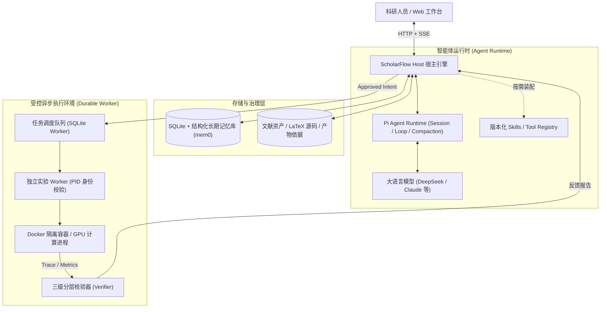

<p align="center"></p>

# ScholarFlow

<p align="center">
  <strong>面向复杂科研长任务的智能体宿主环境（Agent Harness）与自动化研究工作台</strong>
</p>

<p align="center">
  
  
  
  
  
</p>

---

## 📌 项目定位

**ScholarFlow** 是一个专为长期、复杂科研探索设计的 **Agent 宿主环境（Agent Harness）与科研智能体工作台**。

传统 Agent 框架在科研场景下普遍面临三大核心工程痛点：
1. **盲目重试与经验断层**：复杂代码复现与实验遇错时，模型仅能单轮盲目重试，踩坑经验无法系统化沉淀并跨任务复用；
2. **工具过载与语义稀释**：30+ 领域工具全量注入 Prompt 易导致上下文爆炸、Token 浪费与模型调用幻觉；
3. **副作用失控与状态丢失**：模型推理随机重试极易触发不可逆的长耗时实验重复拉起，网络抖动或崩溃时缺乏自愈能力。

ScholarFlow 通过构建**递归自我进化（RSI）闭环**、**任务级动态能力装配（Capability Catalog）**、**Durable Execution 异步持久化容灾**以及**分层证据校验（Verifier）与长期记忆治理**，为大模型提供工业级的高可用、高可靠科研运行时环境。

---

## 🚀 核心架构与技术亮点


### 1. 基于真实执行证据的递归自我进化（RSI, Recursive Self-Improvement）
- **Trace 证据驱动**：在任务遇阻时，自动捕捉系统级客观证据链（Exit Code、Stderr 堆栈、缺失依赖），由 Meta-Agent 针对性提议并生成版本化 Skill 策略补丁；
- **SurfaceSpec 安全边界隔离**：设立严格的可编辑修改面，仅开放领域策略层（`/skills/*.md`），绝对锁死系统核心底层、沙箱权限与宿主控制代码；
- **双重留出集自动化回归**：候选补丁必须在独立的留出任务集（Held-out Tasks）中静默跑批，验证无退化且指标显著提升后，通过乐观版本并发锁原子发布入库，实现经验跨任务持久化复用。

### 2. 任务级动态能力装配与渐进式暴露（Dynamic Tool Orchestration）
- **两阶段渐进式暴露**：初始仅向模型暴露极简的能力目录（Capability Catalog），由 Agent 依据子任务意图自主请求按需加载（`load_capability`）；
- **宿主安全与预算门控**：在宿主层对工具依赖、凭据与 Token 预算实施前置拦截校验，并在请求间动态重构当前会话的活动工具集（`setActiveTools`）；
- **降本增效**：单轮上下文 Tool Schema 占用 Token 缩减 **58%**，复杂场景下工具选择准确率从 **71.4% 提升至 89.2%**。

### 3. 有副作用工具的异步持久化与容灾恢复（Durable Execution）
- **会话与执行深度解耦**：Agent 发起耗时实验后立即获得任务句柄并结束本轮长连接，底层由独立 Worker 放入队列异步调度；
- **严格幂等与指纹防重**：引入 `requestId` 幂等键与基于配置超参序列化的 `Fingerprint（哈希指纹）`，杜绝模型重试引发的物理资源重复拉起；
- **PID 身份核验与未知保护**：记录操作系统真实 PID 与纳秒级启动时间戳（ProcessStartTime）。Worker 崩溃重启后执行双重核验，状态未定自动置入 `unknown` 隔离保护，防孤儿进程与误杀。

### 4. 证据链分层校验与冲突消解长期记忆（Verifier & Memory）
- **分层独立 Verifier**：
  - **执行层**：核验进程退出状态与目标产物实际存在性；
  - **归属层**：核验指标数据是否严格绑定本次 `run_id` 与产物哈希，拦截伪造与学术幻觉；
  - **条件层**：核验训练集划分、随机种子与对比基线的一致性。任一层失败均生成结构化差异报告反哺 Agent 自愈；
- **时序长期记忆治理（mem0 架构思想）**：区分用户确认决定与模型推理假设，引入版本号与生效时间区间（`valid_from` / `valid_to`），实现动态上下文压缩与新旧决策无冲突裁决，跨任务关键条件找回率达 **94.5%**。

---

## 🛠️ 系统工作流与拓扑



---

## 🏁 快速开始

### 运行环境
- **Node.js**：`22.19+` 或 `24.x`
- **支持平台**：Linux / macOS / Windows
- **模型支持**：支持 DeepSeek、Claude、OpenAI 等标准接口（通过设置页配置本地加密密钥）

### 安装与启动

```bash
# 1. 克隆仓库
git clone https://github.com/qiqi-feeder/ScholarFlow.git
cd ScholarFlow

# 2. 安装依赖并编译构建
npm ci
npm run build

# 3. 启动本地工作台
npm start
```

访问 `http://127.0.0.1:8787` 进入 ScholarFlow 科研工作台。

---

## 📂 核心代码目录索引

```text
apps/
  ├── server/             # 宿主核心服务 (Agent 会话、权限门控、动态能力装配、记忆治理)
  └── web/                # 科研工作台 Web 前端 (React / Vite)
packages/
  ├── research/           # 科研核心包 (分层 Verifier、时序图文对齐、准入校验、Docling 解析)
  └── experiment-worker/  # 独立实验 Worker (Durable Execution、PID 身份核验、异步队列)
docs/
  ├── AGENT_CAPABILITY_ARCHITECTURE.md   # 系统级 Agent Harness 架构设计规范
  └── AGENT_RESUME_HIGHLIGHTS.md          # 核心机制实现细节与工程技术报告
```

---

## 📄 开源与协议

- 本项目基于 [Apache-2.0 License](LICENSE) 开源。
- 欢迎提交 Issue 与 Pull Request 共同探讨系统级 Agent Harness 工程演进！
