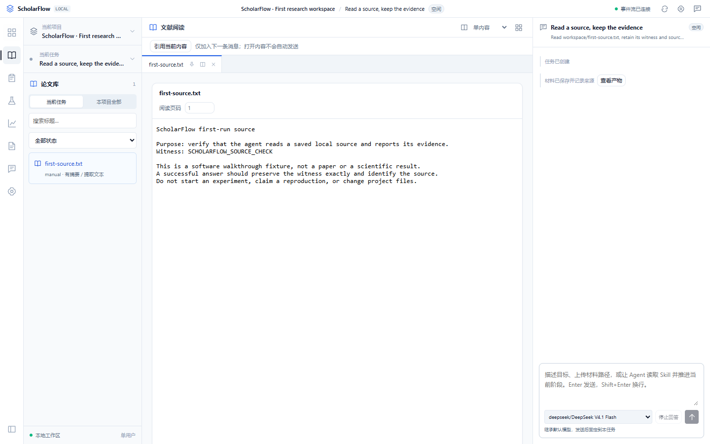
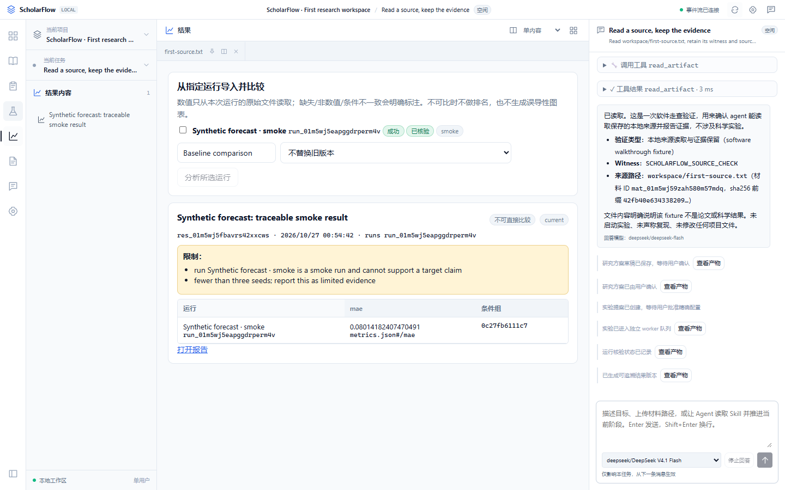
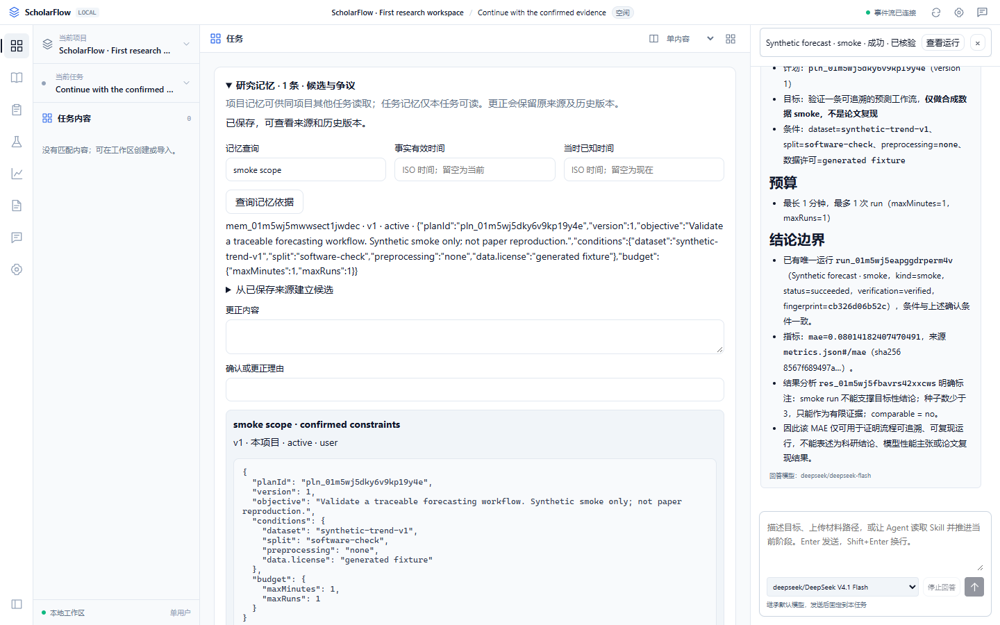

# A traceable research-workspace walkthrough

[English overview](../README.md) · [中文首页](../README.zh-CN.md) · [Documentation](README.md)

This walkthrough uses the running ScholarFlow application, real DeepSeek conversations, and one local CPU smoke process. It follows saved evidence from a source through a result and manuscript, then recalls a confirmed constraint in another task.

**Scope / 范围：** 合成数据上的软件流程演示，包含真实模型、真实本地进程和真实 PDF 编译；不代表论文复现、科研效果或方法改进。


The animation contains 12 real screenshots, each displayed for five seconds. It samples workflow stages and adjusts timing for readability; it is not a continuous real-time screen recording. The interface currently uses Chinese. The [capture manifest](assets/manifest.json) records tool calls, run and source identifiers, hashes, model usage reported for final replies, and asset checksums. Those usage records are not a complete billing statement; prices are not verified.

## Follow the evidence

| Step | What happens | What to inspect |
| --- | --- | --- |
| 1. Read | Import the included local source, attach its saved version, and ask the real agent to read it. | `read_artifact` returns the exact `SCHOLARFLOW_SOURCE_CHECK` witness. |
| 2. Confirm | Review and confirm a synthetic-data plan with one CPU run and a one-minute budget. | The confirmed scope explicitly excludes scientific reproduction. |
| 3. Approve | Inspect the proposed command and explicitly approve it. | One independent worker process writes `metrics.json`; the run retains logs and process identity. |
| 4. Inspect | Open the result generated from that saved run. | MAE is linked to its original file, JSON pointer, hash, and run identifier. |
| 5. Write | Synchronize the result into versioned LaTeX sources and build a PDF. | The generated report and real `query_run` answer both state the smoke-test limitations. |
| 6. Continue | Open a new task and recall the original task's confirmed project constraint. | `recall_memory` returns source-labelled memory and its revision; the experiment is not resubmitted. |

The capture script prepares the fixture plan, result, manuscript, and project memory through the actual host services and APIs. UI automation performs confirmation and approval clicks. These preparatory steps are scripted: the demo does not claim the agent autonomously designed the experiment or wrote the report. Model answers are generated live and are never injected into the conversation.

### Source and conversation



### Metric and provenance



The fixture uses 128 deterministic synthetic samples, a persistence forecast, and seed 42. The observed MAE is approximately **0.08014**. That number validates reading a saved metric; it is not a benchmark or evidence that a method improves forecasting. The run is marked verified only for its software artifacts, with an explicit limitation note.

### Continue in another task



## Try it locally

Follow the [quickstart](../README.md#quickstart) or [中文快速开始](../README.zh-CN.md#快速开始), then run `npm run demo:seed` in a second terminal using the same local configuration. It creates only the included source, project, and task. You send the first message yourself; no experiment or method publication is started by the seed command.

For your own experiment, confirm its real target, data, resource budget, and command in the workspace. The example fixture cannot satisfy the [research acceptance card](RESEARCH_ACCEPTANCE_CARD.md).

## Regenerate the showcase

This optional authoring command makes **three real model conversations with tool loops** and runs one bounded synthetic CPU fixture in an isolated temporary project. It needs a configured DeepSeek key, the built application, Chrome or Edge, `pdflatex`, `bibtex`, and Python with Pillow. Do not run it as a routine offline documentation test. It overwrites showcase assets, then removes the temporary project after closing its host and worker.

```powershell
npm run build
# Optional: point to a Python executable that has Pillow installed.
$env:SCHOLARFLOW_MEDIA_PYTHON='C:\path\to\python.exe'
npm run docs:media
Remove-Item Env:SCHOLARFLOW_MEDIA_PYTHON
npm run test:docs
```

Replace the illustrative Python path or omit that environment setting when `python` already has Pillow. Credentials stay in the local configuration/runtime; they are not exported into the screenshots or manifest. The authoring script uses an isolated server and does not reuse your research projects.

See the [showcase verification record](verification/readme-showcase.md) and [implementation delivery evidence](verification/agent-implementation/IG07.md) for the distinction between documentation checks, software validation, and pending scientific acceptance.
