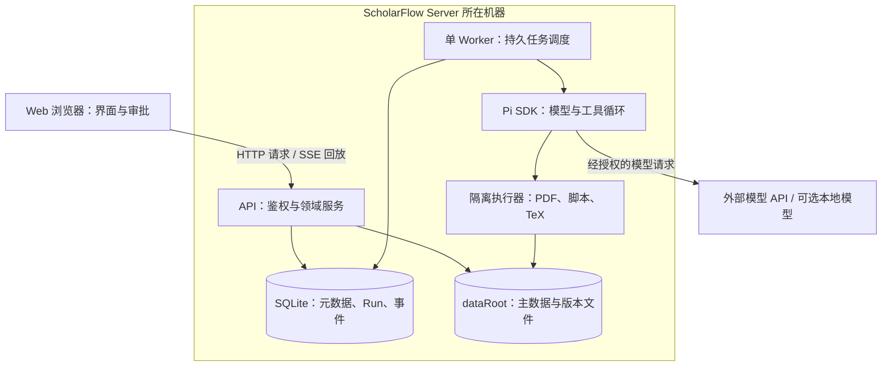

# ScholarFlow 技术方案：可自托管 Server＋Web

> **历史方案，待重新确认**：当前处于需求探索阶段，以 [DISCOVERY](DISCOVERY.md) 中逐项标注的状态为准。本文的架构、接口与工具限制是待评估材料，不构成当前实施授权。

更新：2026-09-16。状态：推荐设计，尚未实现；版本号和依赖在 M1/M3 开工时审计并锁定。对应[产品文档](PRODUCT_DESIGN.md)、[验收路线](IMPLEMENTATION_ROADMAP.md)。

## 1. 决策与范围

首版单用户、自托管、长期运行的 Server，Web 优先，Pi SDK 作为 Agent 引擎。先跑通真实 `nature-reader`，再扩展写作/排版与 Experiment Lite。工作区不是固定 Agent，Server 机器与用户浏览器机器可以不同。

| 决策 | 推荐 | 理由与边界 |
| --- | --- | --- |
| Web | React＋TypeScript＋Vite，客户端 SPA | IDE 工作台不以 SEO/SSR 为目标，先减少服务器渲染复杂度；需自行实现路由、状态与数据请求 |
| API | Node.js LTS＋TypeScript＋Fastify | 与 Pi SDK 同语言；HTTP schema 验证与领域服务分离 |
| 数据 | SQLite＋Drizzle，数据库在 Server 本地盘 | 单用户减少额外运维；ORM 不提供跨数据库自动迁移保证 |
| 后台 | 一个独立长驻 Worker＋SQLite Run/事件记录 | 关网页不终止；先限制并发为 1，非内存队列，不引入 Redis |
| 文件 | 配置化 `dataRoot`＋不可变版本目录 | 真文件与元数据分离，支持校验和/备份；存储适配器以后扩展 |
| 阅读 | PDF.js；Markdown＋数学渲染＋来源适配器 | 不给每个 Skill 写网页生成器；先使用受限、安全的通用渲染 |
| 工具 | 受限业务工具＋隔离执行器 | PDF/脚本/TeX 都可能不可信；Pi 没有自动提供 OS 沙箱 |
| 排版 | 第一版 LaTeX＋PDF，DOCX 后续 | 基于计算型科研的建议，若主用户用 Word 则实施前调整 |
| 测试 | Vitest＋API 集成测试＋Playwright＋真实模型评测 | 确定性测试与模型质量分开，现有 PowerShell Demo 测试保留 |

选型依据：[React SPA 指南](https://react.dev/learn/build-a-react-app-from-scratch)、[Fastify TypeScript](https://fastify.dev/docs/latest/Reference/TypeScript/)、[Drizzle](https://orm.drizzle.team/docs/overview)、[PDF.js](https://mozilla.github.io/pdf.js/getting_started/)、[Vitest](https://vitest.dev/guide/)、[Playwright](https://playwright.dev/docs/intro)。这些是本项目的推荐组合，不是上游对 ScholarFlow 的背书。Node 与依赖须核验支持范围及安全补丁，采用锁文件和可复现镜像，不用浮动 `latest` 发布。[Node 发布周期](https://nodejs.org/en/about/previous-releases)

## 2. 架构与执行边界



可编辑源图：[architecture.drawio](diagrams/architecture.drawio)，[浏览器查看说明](diagrams/README.md)。图是目标架构，不是当前部署快照。

Web 不直接访问 SQLite、Pi 凭据或 Server 绝对路径；Pi 不直接取得整个 `dataRoot`/数据库的自由写权限。API 与 Worker 分进程，先同机部署；HTTP 服务自身不执行用户 shell。任务只通过授权业务工具操作资产，危险计算进入执行器。

第一版不使用短生命周期 Serverless Function 执行 Agent 长任务，不用 WebSocket 连接生命周期代替任务生命周期。前端统一 HTTP 协议，后续 Electron 可复用。

## 3. 建议仓库架构

以下是计划新增目录，不表示当前已存在：

```text
apps/
  web/src/
    shell/                    # 活动栏、标签页、分栏、连接状态
    features/                 # projects/papers/reader/notes/evidence/writing/experiments/agent
  server/src/
    http/                     # schema、路由、鉴权、SSE
    services/                 # 领域服务、事务、权限、审批
  worker/src/                 # 调度、心跳、取消、恢复策略
packages/
  contracts/                 # API/事件/资产契约，带 schemaVersion
  domain/                    # 领域类型与纯规则，不依赖 React/Pi
  db/                        # SQLite schema、迁移、repository
  storage/                   # 文件版本、路径约束、备份
  agent-runtime/             # PiAdapter、Session 快照、事件转换
  skills/                    # 受控注册、依赖报告、资源解析、快照
  tools/                     # 工具策略、审批、受限业务工具
  renderers/                 # Markdown/源锚点/表格的通用渲染
  executor/                  # 隔离执行器协议与实现
toolchains/                  # 固定版本 PDF/TeX/Python 执行镜像
tests/
  fixtures/                  # 自有/许可材料、金标准、恶意样例
  integration/               # DB/文件/API/Worker/真实 SDK
  e2e/                       # 浏览器全链路
  evals/                     # 明确触发的真实模型评测
deploy/                      # 自托管配置、健康检查、备份恢复说明
demo/                        # 现有原始与明亮 Demo 原样保留
docs/                        # 产品、技术、路线、设计与验收记录
```

依赖方向：Web→contracts/renderers；HTTP/Worker→services/domain；services→repository/storage；agent-runtime 只通过 tools 调用业务服务。领域层不得 import React、Electron 或 Pi 包；Web 不得 import Node 文件/凭据模块。不要先抽象多套数据库/执行引擎，边界清楚即可。

UI 服务端数据由请求缓存层管理，布局/选项由轻量客户端状态管理；不能拿聊天数组当项目数据库。请求携带 projectId，后端从鉴权身份校验访问，不信任客户端选择。

## 4. 数据、存储与版本

### 4.1 最小领域模型

| 实体 | 关键字段/规则 |
| --- | --- |
| Project | id、ownerId、目标、归档状态；首版 owner 仅一个 |
| Artifact / ArtifactVersion | projectId、type、版本、storageKey、hash、mime、来源 runId；版本不可变 |
| Paper / SourceBlock | 源 PDF 版本、页码、blockId、bbox/文本校验值、解析器版本 |
| Note / Evidence / Citation | 内容版本、源资产版本、页/块、事实/推断分类 |
| Conversation / SessionSnapshot | UI 对话与 Pi Session 映射，分开持久化；快照记录 SDK/schema 版本 |
| AgentRun / RunEvent | 输入快照、模型、Skill/package hash、权限快照、状态、attemptId；事件 seq 单调递增 |
| SkillPackage / ProjectSkill / WorkspacePreference | 来源 commit、资源清单、能力报告、启用范围、默认选项 |
| ChangeProposal / Approval | diff、expectedVersion、动作/参数 hash、runAttemptId、审批人、过期时间、状态 |
| Manuscript / Build | 源版本、模板/toolchain hash、引用校验、日志、exitCode、PDF 版本 |
| ExperimentRun | 代码/环境/config/seed/input hash、命令 argv、输出指标与 hash、日志、exitCode |

所有关联都校验同一 Project；只有显式授权的复制/关联服务可以跨项目。来源绑定不可变版本，PDF 换版后不得静默复用旧 bbox。删除默认归档/软删除，永久清理需单独确认与保留策略。

### 4.2 Server 文件布局

```text
dataRoot/
  scholarflow.sqlite          # 本地盘，含 Run/事件/业务元数据
  projects/<id>/
    assets/<assetId>/<version>/
    readers/<artifactId>/<version>/
    manuscripts/<id>/<version>/
    experiments/<runId>/
  skills/<sourceId>/<commit>/  # 保留完整包结构，包括合法共享资源
  runs/<runId>/<attemptId>/    # 暂存、审计与检查报告
  private/                    # Server 凭据，工具/HTTP 下载永不可读
```

目录名使用服务端 ID，不拼接用户上传名。先在 run staging 写产物，扫描类型/路径/体积并校验，发布到不可变版本目录，再在事务中登记；DB 登记前崩溃产生的孤儿目录隔离回收，不能暴露成成功产物。覆盖写采用 expectedVersion CAS；审批只批准具体版本和具体 patch。

SQLite 建议 WAL、短事务、busy timeout、外键与明确同步策略，迁移保留回滚/恢复说明；核验实际 SQLite driver 和内核补丁版本。数据库不得放在 NFS/SMB 网络盘；大数据资产以后可外置，SQLite 仍留同机本地盘。WAL 备份需使用一致性备份方式，不直接复制单一 `.sqlite` 文件。[SQLite 使用场景](https://www.sqlite.org/whentouse.html)、[WAL 限制与持久性](https://www.sqlite.org/wal.html)

首次备份方案可以停 Worker、阻止写入、完成一致性 DB 备份并快照不可变文件/配置，hash 清单验收后恢复服务。凭据不包含在普通导出包；恢复时重新配置或使用独立加密密钥备份。缓存可重建，主文件与元数据必须一致。

## 5. HTTP 与事件契约

API 前缀 `/api/v1`；响应区分业务状态与 HTTP 错误，错误有 code、requestId、可重试提示，不返回凭据或宿主路径。上传必须限大小/类型并校验实际内容；大 PDF 支持鉴权 Range 请求。

| 接口（规划） | 作用 |
| --- | --- |
| `GET /health` / `GET /api/v1/capabilities` | 无敏感健康信息 / 鉴权后的版本、PDF/OCR/TeX/模型能力 |
| `POST /api/v1/auth/session` / `DELETE /api/v1/auth/session` | 建立/撤销单用户登录态，不能在 URL 传秘密 |
| `/api/v1/projects` / `/projects/:id/assets` | 项目与上传/查询，实际完整路由都在 `/api/v1` 下 |
| `GET /api/v1/projects/:id/skills` / `POST /api/v1/skills/import` | 可用库/报告；导入需审批与来源约束 |
| `POST /api/v1/projects/:id/runs` | 输入 skillIds/版本、sourceArtifactVersions、outputTarget、profile、幂等键；202 返回 runId |
| `GET /api/v1/runs/:id` / `GET /api/v1/runs/:id/events` | 查询状态 / SSE 持久事件回放 |
| `POST /api/v1/runs/:id/cancel` / `POST /api/v1/runs/:id/retry` | 请求取消 / 经确认创建新 attempt，记录成本风险 |
| `POST /api/v1/proposals/:id/approve` | 版本与动作 hash 匹配后批准，拒绝陈旧/跨项目审批 |
| `/api/v1/projects/:id/manuscripts` / `/builds` / `/experiments` | 稿件、排版构建与实验业务入口 |
| `GET /api/v1/artifacts/:id/versions/:version/content` | 鉴权读取类型受限文件，不接受任意绝对路径 |

`Idempotency-Key` 与身份、project、动作绑定；同键同参数返回原 runId，同键不同参数 409。幂等记录覆盖任务保留期，不能靠页面禁用按钮保证无重复。

SSE 事件封装：`schemaVersion, runId, attemptId, seq, type, timestamp, payload`。类型包括状态、文本批次、资源加载、工具开始/完成、审批、产物登记与校验结果。不持久化/展示模型隐藏推理，日志默认脱敏。

事件先持久化后发布，客户端按 seq 去重；刷新/断线通过事件 ID/`Last-Event-ID` 或显式 cursor 回放同一 Run，不重新 POST 任务。不为每个 token 写 DB 行，使用可恢复文本批次；终态包含完整消息与最终 seq。游标过期返回完整快照＋新游标，不静默丢内容。SSE 心跳、代理禁缓冲、客户端慢消费限流都需测试。[SSE 协议](https://developer.mozilla.org/en-US/docs/Web/API/Server-sent_events/Using_server-sent_events)

初版同源登录 cookie（HttpOnly，远程 Secure，合适 SameSite）＋写接口 CSRF/Origin 校验；SSE 每次连接鉴权，注销/撤权时已有流也应关闭。避免为 EventSource 把 token 放进查询参数。生产推荐 Server 同源提供打包 Web；远程连线 UI 是明确配置，不默认允许任意 CORS。

## 6. Pi 接入与持久任务

### 6.1 PiAdapter

以 `createAgentSession` 创建执行 Session，以订阅接口转换事件，以 abort 请求中止；业务层只依赖 PiAdapter。当前官方 SDK 示例使用 `@earendil-works/pi-coding-agent`，M3 必须核验实际包导出/版本、模型凭据与自定义工具接口后锁定，不能照搬旧包名。[Pi SDK](https://pi.dev/docs/latest/sdk)

关键不是在 HTTP 中调用一次 prompt，而是控制资源与工具：

- 使用应用独立的配置/凭据位置和受控 ResourceLoader，不自动加载机器全局/项目 `.pi` 扩展、父目录上下文或未知技能目录。
- 默认关闭内置通用工具（当前 SDK 的 `noTools: "builtin"`），只允许经过测试的自定义工具；若配置 tools allowlist 必须包含自定义工具名称。
- 显式 Skill 正文与资源读取日志进入任务上下文。资源读取工具必须返回完整内容或明确分页/EOF，不能截断后标“已加载”。
- 受限工具如 `read_skill_resource`、`read_source_blocks`、`propose_artifact`、`validate_artifact`、`compile_manuscript`、`run_experiment`；能力预检检查上游所需工具语义是否有安全映射。
- 内存 Session 配合版本化持久快照可用于执行；终态恢复对话/分支要验证 SDK 的恢复 API。快照不可读时保留产物和事件，提示不兼容，不猜测恢复。

### 6.2 Run 状态与恢复

`queued → running → waiting_approval → running → succeeded / failed / cancelled`；进程丢失或外部动作结果未知转 `interrupted`。模型跑完但产物校验不通过不得标成功；不完整可保存明确的 draft 资产。

API 先持久化 Run，再返回 202。单 Worker 原子 claim，记录进程实例/attempt、心跳与超时；同一 Session 串行。第一版只有一个活跃任务，等待审批也占执行槽，UI 显示队列，审批有过期时间。第二个 Worker 不获执行许可，避免先做脆弱分布式队列。

进程重启后：未 claim 的 queued 可继续；旧 running/waiting_approval 标 interrupted，**不自动重发模型请求**或执行旧审批。用户重试生成新 attempt，从已确认产物/checkpoint 发起，并告知可能重复计费。不得宣称外部模型/文件操作 exactly-once；副作用使用幂等业务动作和版本提交保护。

取消先持久化请求，Worker 调用 abort 并结束/清理隔离子进程；仅关闭浏览器不 abort。已经完成的副作用保留审计，取消不是回滚。对无法确定是否完成的外部动作标 interrupted，不能假装 cancelled 已恢复原状。SDK 自动重试也要设预算、次数和工具幂等约束。

## 7. Skill 系统：通用执行，不硬编码每套流程

1. **导入**：用户提供允许的仓库/本地 Server 包；预检后固定 commit/hash、许可证、资源清单，不自动运行安装脚本。
2. **依赖报告**：解析 Skill 元数据及支持的声明式 manifest；检查共享路径、脚本、Python/TeX/OCR、其他 Skill 和宿主专有机制。未声明依赖允许运行前探测并转 blocked，不凭描述认定兼容。
3. **作用域**：用户库→项目启用→工作区建议；同名冲突按 sourceId/版本显示，不任意覆盖。对话 explicit selection 决定本次任务，自动推荐需确认。
4. **快照**：启动 Run 固定包/输入/输出/权限快照。更新库不影响运行中任务；禁用危险能力可立即阻断后续工具，须留审计。
5. **执行**：宿主完整加载选中 `SKILL.md`；按其路由加载必要核心、匹配片段和按需引用，记录路径/hash/读取范围。普通资源渐进加载，不一股脑塞所有片段。
6. **产物**：Skill 产出文件，通用 Artifact pipeline 校验/版本化，renderer 按类型展示。行业验证器是显式插件，不是替 Skill 假造正文的业务代码。

路径解析以允许的 packageRoot 为边界：`../nature-shared` 可以在完整 nature 包内部访问，但不能越过包根；检查 canonical path、symlink/junction、归档解压穿越与重定向。只复制 `nature-reader` 子目录可能丢共享资源，必须报告阻断。不得读取 Server 的凭据目录。

Pi 支持 Agent Skills 的渐进加载及显式命令，但不同宿主 hooks/MCP/子代理等不自动相通。我们实现同类选择与执行体验，不承诺结果完全一致；通用 manifest 也不是所有 Skill 的强制标准。[Pi Skills](https://pi.dev/docs/latest/skills)

### 7.1 首条 nature-reader 集成

固定上游包，依其 [manifest](https://github.com/Yuan1z0825/nature-skills/blob/main/skills/nature-reader/manifest.yaml) 读取 always_load（含 shared）和选定来源片段；PDF 输入还要检查其要求的 pdf Skill、解析工具与公式验证脚本是否可解析/安全执行。未解析依赖不得发出“完全兼容”结论。上游正文/manifest 的自报版本可能不同，以 commit/hash 作为真实版本，报告差异。

正文路径按[输出契约](https://github.com/Yuan1z0825/nature-skills/blob/main/skills/nature-reader/static/core/output-contract.md)登记；按上游 schema 读取 source_map，不随意改坏其字段，必要的应用扩展放 namespaced 元数据。独立验证 JSON、双语块配对、源位置、图片存在/配对、数学定界与公式锚点。预检核验上游 `scripts/validate_reader_math.py` 的实际位置/依赖，在隔离环境执行，再运行宿主的 source/asset 校验。测试不得由前端模拟工具消息来替代真正加载。

合法自有短论文先验证两种任务：全文双语阅读＋后续有来源问答；选段请求不得生成全文。扫描/缺页等作为失败或 draft 负例。只有全部必要校验通过才能发布 complete 阅读资产，未完成必须留 notes 和可见质量状态。

## 8. 写作排版与实验执行

写作流程：绑定证据/图表版本→Skill 生成 ChangeProposal→引用/格式检查→用户审批→CAS 保存 Manuscript 新版本→确定性 Build→PDF 验证与预览。旧批准不能覆盖新编辑；引用 key 必须真实存在，论文事实引用可定位来源。

TeX 在固定镜像、非 root、无 shell-escape、默认无网络、无宿主敏感挂载的执行器中构建；离线预装允许的模板/包，限制 CPU/内存/时间/输出大小。禁止构建时自动下载模板代码。真实 PDF 要检查页数、关键文本、图片与布局，单看 exitCode 不足。编译失败保留上次成功版本，但清楚显示不是本次输出。

Experiment Lite 先导入规范结果，再批准固定 CPU 样例：明确 argv、代码 hash、镜像/依赖版本、输入、seed 与输出目录。只挂载必要输入只读，输出限单独 staging；不挂整个用户目录，不提供 Docker socket。固定样例重跑按指标容差验收，完整保存日志/环境/校验值；GPU 和多机执行以后加 provider。

容器是隔离措施之一，不是万能安全保证；对恶意/不可信代码依威胁模型采用更强 VM/沙箱或禁执行。Windows/Mac 首版可运行无危险工具的 Server，执行器需已安装兼容容器运行环境；缺执行器则 capability 显示 blocked，绝不退回宿主 shell。Linux 作为首个完整自托管验证目标，其他平台纳入后续明确验收。

## 9. 安全与运维底线

Pi 没有内置 OS 沙箱，cwd/项目 trust 不能替代文件与进程隔离；未审查扩展与脚本继承进程权限。[Pi 安全文档](https://pi.dev/docs/latest/security)

- 启动默认绑定 loopback，跨机器监听必须显式启用并配置登录/可信入口；不能直接公网暴露未完成 M8 的开发服务。
- 外部全文、模型输出、Skill 指令均是不可信数据，不能触发授权/宿主配置变更；审批绑定动作/输入版本/hash，有期限且一次消费。
- HTML/Markdown 清洗，禁任意脚本和危险 URL；生成 HTML 只下载或严格独立来源 sandbox 预览。资源下载鉴权，不能借图片路径跨项目或越界读文件。
- URL 导入与检索防 SSRF：协议/域名允许列表，DNS/重定向/IP 校验，禁止内网/metadata 地址（显式配置的本地模型入口单独授权），限制体积/超时。
- 密钥只在 Server 私有配置与模型访问代理，工具容器无凭据；普通日志与导出脱敏。网络白名单对模型/来源/执行器分别管理。
- 限上传、队列、执行、事件保留与磁盘配额；磁盘满必须可诊断，不登记损坏文件为成功。
- 记录 requestId/runId/attemptId/toolCallId、耗时/成本/退出码；不记录秘密和隐藏推理。备份要实际恢复到空目录验证，而非仅检查“备份文件存在”。

## 10. 扩展与待确认决策

多用户/多 Worker 时再评估 PostgreSQL 与成熟任务队列；触发条件是多人需求、并发或 SQLite 写入/队列等待瓶颈的实际观测。迁移要做数据导出/转换/对账/回滚，不能只换 ORM driver。对象存储、远程执行器通过边界适配，仍需新的权限与失败测试。

Electron 复用 Web/HTTP，可连接远程 Server 或由桌面主进程托管本机 Server。新增窄 IPC、服务启动/退出、更新和平台验收；保持 contextIsolation、禁渲染器 Node，自托管凭据不注入任意网页。[Electron 安全建议](https://www.electronjs.org/docs/latest/tutorial/security)

实施前需要确认：首个部署 OS、首批用户 LaTeX/Word 偏好、模型/预算、论文许可、可安装执行器条件。默认按“Linux 完整 Server、浏览器跨机器、LaTeX、用户自带模型凭据、自有测试论文”推进，若不同需调整相应验收，不能静默改变产品范围。
